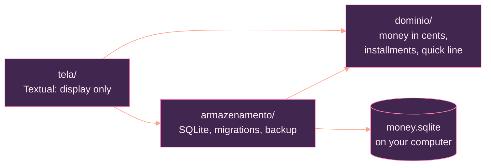

<p align="center">
  
</p>

<p align="center"><a href="README.md">Português</a> · <b>English</b></p>

<p align="center">
  
  
  
  
</p>

<p align="center">
  
  
  
</p>

<p align="center"><sub>Built with Python, Textual, SQLite and Claude</sub></p>

<p align="center"></p>

# Kotsu

**Kotsu** (コツコツ, *kotsukotsu*) is a Japanese word for "little by little, steadily". It is a terminal app for everyday money: income, expenses and the month's installments on a single screen, in a pink and salmon **Cotton Candy** look. No giant spreadsheet, no dashboard full of charts. You jot an entry on one line, see the whole month and get on with your day.

It runs on Windows Terminal and Linux, works offline and keeps everything in a SQLite file on your computer. No account, no cloud, no telemetry, no ads.

> The app interface is in Brazilian Portuguese for now (labels such as *receitas* = income, *despesas* = expenses, *saldo* = balance). The commands and keys below work the same in any language.

## Contents

- [I. What it does](#i-what-it-does)
- [II. Install](#ii-install)
- [III. Use](#iii-use)
- [IV. Your data and backups](#iv-your-data-and-backups)
- [V. Under the hood](#v-under-the-hood)
- [VI. Development](#vi-development)
- [VII. License](#vii-license)

## I. What it does

<table>
  <tr>
    <td width="72" align="center"></td>
    <td><b>Quick line</b><br><code>89,90 mercado #alimentação @nubank</code> and Enter. No forms: the amount comes first, then account, category and date in any order.</td>
  </tr>
  <tr>
    <td align="center"></td>
    <td><b>One screen</b><br>Income, expenses and balance for the month, one line per account (each with its own color) and the list of entries. The ← / → arrows switch months.</td>
  </tr>
  <tr>
    <td align="center"></td>
    <td><b>Installments and "every month"</b><br><code>120 geladeira @nubank 10x</code> becomes 10 installments, one per month. Categories marked "every month" (rent, internet, salary) show up on their own, with a <code>↻</code>.</td>
  </tr>
  <tr>
    <td align="center"></td>
    <td><b>Two Cotton Candy themes</b><br>Night (default) and light, with hearts, a little face and "zzz… zerada" when an account is empty. The <code>t</code> key switches and your choice is saved.</td>
  </tr>
  <tr>
    <td align="center"></td>
    <td><b>Keyboard first</b><br>Everything has a key, and the footer reminds you which. Filter by <code>@account</code> or <code>#category</code> with <code>/</code>.</td>
  </tr>
  <tr>
    <td align="center"></td>
    <td><b>Truly private</b><br>Your data stays on your computer. Kotsu never sends anything over the network.</td>
  </tr>
</table>

## II. Install

<table>
  <tr>
    <td width="72" align="center"></td>
    <td>Requires Python 3.11 or newer and <a href="https://pipx.pypa.io/">pipx</a>. The package is not on PyPI yet: install straight from GitHub.</td>
  </tr>
</table>

Windows Terminal (PowerShell), in one line:

```powershell
irm https://raw.githubusercontent.com/Sera-DAI/kotsu/main/instalar.ps1 | iex
```

Linux/macOS (needs pipx; the script tells you if it is missing):

```bash
curl -fsSL https://raw.githubusercontent.com/Sera-DAI/kotsu/main/instalar.sh | bash
```

Or step by step, without a script:

Windows Terminal (PowerShell):

```powershell
py -m pip install --user pipx
py -m pipx ensurepath
py -m pipx install git+https://github.com/Sera-DAI/kotsu.git
```

Linux (Debian/Ubuntu):

```bash
sudo apt install pipx
pipx ensurepath
pipx install git+https://github.com/Sera-DAI/kotsu.git
```

Reopen the terminal and run `kotsu`. To update: `pipx upgrade kotsu-cli` (or run the installer again). To remove: `pipx uninstall kotsu-cli` (your data stays in the data folder).

## III. Use

```text
 ☁ Algodão-Doce ☁   novembro de 2026

 ♡ receitas 3.500,00   ✧ despesas 432,90   ☆ saldo 3.067,10   (◕‿◕)♡

 ♡ itaú     ♥♥♥♥♥♥♥♥♥♥♥♥♥♥·    -210,50  +3.500,00
 ♡ nubank   ♥♥♥♥♥♥♥♥♥♥♥♥♥♥     -222,40

 Data   Descrição   Categoria     Conta    Valor
 08/11  padaria     alimentação   nubank   12,50
 07/11  mercado     alimentação   nubank   89,90
```

| Key | Action |
|---|---|
| `l` | opens the quick line (Enter saves, Esc closes) |
| ← / → | previous / next month |
| `/` | filters by `@account`, `#category`, both, or just a name (empty Enter or Esc clears) |
| `e` | edits the selected entry in the quick line, date included |
| `c` | copies the selected entry into the quick line, dated today |
| `d` | deletes the selected entry (an installment asks "only this one or all?") |
| `r` | renames the selected entry |
| `m` | turns "every month" on/off for the selected entry's category |
| `b` | manual database backup (a new copy in `backups/`) |
| `t` | switches the theme (Cotton Candy night or light) |
| `q` | quits |

The line starts with the amount; the rest comes in any order:

```text
89,90 mercado #alimentação @nubank     expense (no sign)
+3500 salário @itaú                    income
120 geladeira #casa @nubank 10x        10 installments of 120.00, one per month
45 farmácia ontem                      date: ontem (yesterday), 15/10 or 15/10/2025 (default: today)
```

Every entry needs an `@account`; without one the line is not saved. An account or category that does not exist yet asks whether to create it. Editing or renaming an installment asks "only this one or all?". Amounts use a decimal comma and dates are day/month, as in Brazil.

### ↻ Categories that repeat every month

When you create a category, Kotsu asks whether it repeats every month (or press `m` on an existing one). Every new entry in it reappears each month with the same amount, account and day (day 31 becomes the last day of the month), with no end, until you stop it. Months appear as you navigate with ← / →, up to 24 months ahead of today. Deleting, editing or renaming one asks "only this month or the following ones?".

## IV. Your data and backups

<table>
  <tr>
    <td width="72" align="center"></td>
    <td>
      <ul>
        <li><b>Where it lives:</b> <code>%APPDATA%\money-cli</code> on Windows and <code>~/.local/share/money-cli</code> on Linux (or the folder in the <code>MONEY_CLI_DADOS</code> variable). <code>kotsu --dados FOLDER</code> opens another folder.</li>
        <li><b>Manual backup:</b> the <code>b</code> key creates <code>backups/money.YYYY-MM-DD-HHMMSS.sqlite</code> and keeps the 5 most recent copies. Kotsu never backs up on its own.</li>
        <li><b>No password or encryption:</b> protect your computer and the folder as you would any personal file.</li>
        <li><b>Restore:</b> close the app, move the current <code>money.sqlite</code> elsewhere, copy the chosen backup to <code>money.sqlite</code>, open the app and check the totals.</li>
      </ul>
    </td>
  </tr>
</table>

## V. Under the hood

<table>
  <tr>
    <td width="72" align="center"></td>
    <td>Three layers, and a test fails if one of them imports what it must not. Financial rules (totals, installments, the quick-line parser) live in the domain; the screen only displays.</td>
  </tr>
</table>



- Money is an integer number of cents, never a `float`; the sign comes from the type (income or expense).
- Every write is a transaction: all or nothing. Changed the schema? A numbered migration, with a copy of the database made first.
- Totals are never stored: SQL computes them per month.

Full contributor rules (in Portuguese): [AGENTS.md](AGENTS.md).

## VI. Development

<table>
  <tr>
    <td width="72" align="center"></td>
    <td>Requires Python 3.11+. The tests never touch the network.</td>
  </tr>
</table>

```bash
git clone https://github.com/Sera-DAI/kotsu.git
cd kotsu
python -m venv .venv
# Windows: .venv\Scripts\activate    Linux: source .venv/bin/activate
pip install -e ".[dev]"
kotsu --dados ./tmp                          # uses a test folder
python ferramentas/verificar.py --rapido     # lint + fast tests
python ferramentas/verificar.py              # everything, same as CI
```

## VII. License

<table>
  <tr>
    <td width="72" align="center"></td>
    <td><a href="LICENSE">MIT</a>. Made with care, little by little.</td>
  </tr>
</table>

<p align="center"></p>
