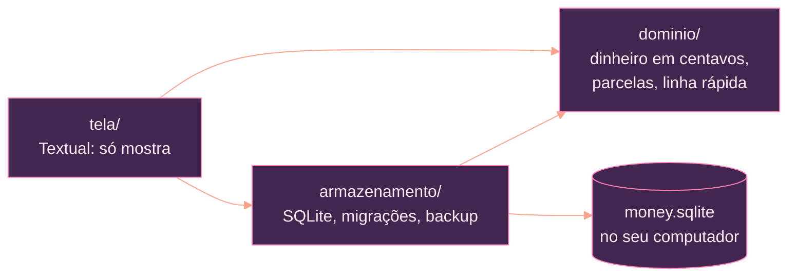

<p align="center">
  
</p>

<p align="center"><b>Português</b> · <a href="README.en.md">English</a></p>

<p align="center">
  
  
  
  
</p>

<p align="center">
  
  
  
</p>

<p align="center"><sub>Feito com Python, Textual, SQLite e Claude</sub></p>

<p align="center"></p>

# Kotsu

**Kotsu** (コツコツ, *kotsukotsu*) quer dizer "aos pouquinhos, com constância". É um app de terminal para as finanças do dia a dia: receitas, despesas e parcelas do mês numa tela só, com o visual **Algodão-Doce** em rosa e salmão. Nada de planilha gigante nem painel cheio de gráfico. Você anota numa linha, vê o mês inteiro e segue com o seu dia.

Roda no Windows Terminal e no Linux, funciona sem internet e guarda tudo num arquivo SQLite no seu computador. Não tem conta, nuvem, telemetria nem anúncio.

## Sumário

- [I. O que ele faz](#i-o-que-ele-faz)
- [II. Instalar](#ii-instalar)
- [III. Usar](#iii-usar)
- [IV. Seus dados e backup](#iv-seus-dados-e-backup)
- [V. Como é por dentro](#v-como-é-por-dentro)
- [VI. Desenvolvimento](#vi-desenvolvimento)
- [VII. Licença](#vii-licença)

## I. O que ele faz

<table>
  <tr>
    <td width="72" align="center"></td>
    <td><b>Linha rápida</b><br><code>89,90 mercado #alimentação @nubank</code> e Enter. Sem formulário: o valor vem primeiro, e conta, categoria e data entram em qualquer ordem.</td>
  </tr>
  <tr>
    <td align="center"></td>
    <td><b>Uma tela só</b><br>Receitas, despesas e saldo do mês, uma linha por conta (cada uma com a sua cor) e a lista de lançamentos. Setas ← / → trocam de mês.</td>
  </tr>
  <tr>
    <td align="center"></td>
    <td><b>Parcelas e "todo mês"</b><br><code>120 geladeira @nubank 10x</code> vira 10 parcelas, uma por mês. Categorias marcadas como "todo mês" (aluguel, internet, salário) reaparecem sozinhas, com um <code>↻</code>.</td>
  </tr>
  <tr>
    <td align="center"></td>
    <td><b>Dois temas Algodão-Doce</b><br>Noite (padrão) e claro, com corações, rostinho e "zzz… zerada" quando a conta está vazia. A tecla <code>t</code> troca e a escolha fica salva.</td>
  </tr>
  <tr>
    <td align="center"></td>
    <td><b>Teclado primeiro</b><br>Tudo tem uma tecla, e o rodapé lembra qual. Filtra por <code>@conta</code> ou <code>#categoria</code> com <code>/</code>.</td>
  </tr>
  <tr>
    <td align="center"></td>
    <td><b>Privado de verdade</b><br>Os dados ficam no seu computador. O Kotsu nunca envia nada para a rede.</td>
  </tr>
</table>

## II. Instalar

<table>
  <tr>
    <td width="72" align="center"></td>
    <td>Requer Python 3.11 ou mais recente e o <a href="https://pipx.pypa.io/">pipx</a>. O pacote ainda não está no PyPI: instale direto do GitHub.</td>
  </tr>
</table>

Windows Terminal (PowerShell):

```powershell
py -m pip install --user pipx
py -m pipx ensurepath
py -m pipx install git+https://github.com/Sera-DAI/kotsu-cli-project.git
```

Linux (Debian/Ubuntu):

```bash
sudo apt install pipx
pipx ensurepath
pipx install git+https://github.com/Sera-DAI/kotsu-cli-project.git
```

Reabra o terminal e rode `kotsu`. Para atualizar: `pipx upgrade kotsu-cli`. Para remover: `pipx uninstall kotsu-cli` (seus dados continuam na pasta de dados).

## III. Usar

```text
 ☁ Algodão-Doce ☁   novembro de 2026

 ♡ receitas 3.500,00   ✧ despesas 432,90   ☆ saldo 3.067,10   (◕‿◕)♡

 ♡ itaú     ♥♥♥♥♥♥♥♥♥♥♥♥♥♥·    -210,50  +3.500,00
 ♡ nubank   ♥♥♥♥♥♥♥♥♥♥♥♥♥♥     -222,40

 Data   Descrição   Categoria     Conta    Valor
 08/11  padaria     alimentação   nubank   12,50
 07/11  mercado     alimentação   nubank   89,90
```

| Tecla | Ação |
|---|---|
| `l` | abre a linha rápida (Enter salva, Esc fecha) |
| ← / → | mês anterior / seguinte |
| `/` | filtra por `@conta`, `#categoria`, os dois ou só o nome (Enter vazio ou Esc tira) |
| `e` | edita o selecionado na linha rápida, inclusive a data |
| `c` | copia o selecionado para a linha rápida, com a data de hoje |
| `d` | exclui o selecionado (parcela pergunta "só esta ou todas?") |
| `r` | renomeia o selecionado |
| `m` | liga/desliga "todo mês" na categoria do selecionado |
| `b` | backup manual do banco (cópia nova em `backups/`) |
| `t` | troca o tema (Algodão-Doce noite ou claro) |
| `q` | sai |

A linha começa pelo valor; o resto vem em qualquer ordem:

```text
89,90 mercado #alimentação @nubank     despesa (sem sinal)
+3500 salário @itaú                    receita
120 geladeira #casa @nubank 10x        10 parcelas de 120,00, uma por mês
45 farmácia ontem                      data: ontem, 15/10 ou 15/10/2025 (padrão: hoje)
```

Todo lançamento precisa de `@conta`; sem ela a linha não salva. Conta ou categoria que não existe pergunta se deve criar. Editar ou renomear uma parcela pergunta "só esta ou todas?".

### ↻ Categorias que se repetem todo mês

Ao criar uma categoria o Kotsu pergunta se ela repete todo mês (ou use `m` numa categoria existente). Todo lançamento novo nela reaparece em cada mês, com o mesmo valor, conta e dia (dia 31 vira o último dia do mês), sem fim, até você mandar parar. Os meses aparecem ao navegar com ← / →, até 24 meses à frente de hoje. Excluir, editar ou renomear um deles pergunta "só este mês ou os próximos?".

## IV. Seus dados e backup

<table>
  <tr>
    <td width="72" align="center"></td>
    <td>
      <ul>
        <li><b>Onde ficam:</b> <code>%APPDATA%\money-cli</code> no Windows e <code>~/.local/share/money-cli</code> no Linux (ou a pasta da variável <code>MONEY_CLI_DADOS</code>). <code>kotsu --dados PASTA</code> abre outra pasta.</li>
        <li><b>Backup manual:</b> a tecla <code>b</code> cria <code>backups/money.AAAA-MM-DD-HHMMSS.sqlite</code> e mantém as 5 cópias mais recentes. O Kotsu não faz backup sozinho.</li>
        <li><b>Sem senha nem criptografia:</b> proteja o computador e a pasta como protegeria qualquer arquivo pessoal.</li>
        <li><b>Restaurar:</b> feche o app, guarde o <code>money.sqlite</code> atual em outra pasta, copie o backup escolhido para <code>money.sqlite</code>, abra e confira os totais.</li>
      </ul>
    </td>
  </tr>
</table>

## V. Como é por dentro

<table>
  <tr>
    <td width="72" align="center"></td>
    <td>Três camadas, e um teste falha se uma delas importar o que não pode. A regra financeira (totais, parcelas, a linha rápida) mora no domínio; a tela só mostra.</td>
  </tr>
</table>



- Dinheiro é inteiro em centavos, nunca `float`; o sinal vem do tipo (receita ou despesa).
- Toda escrita é uma transação: grava tudo ou nada. Mudou o esquema? Migração numerada, com cópia do banco antes.
- Os totais nunca são gravados: o SQL calcula por mês.

Regras completas para quem contribui: [AGENTS.md](AGENTS.md).

## VI. Desenvolvimento

<table>
  <tr>
    <td width="72" align="center"></td>
    <td>Requer Python 3.11+. Os testes nunca acessam a rede.</td>
  </tr>
</table>

```bash
git clone https://github.com/Sera-DAI/kotsu-cli-project.git
cd kotsu-cli-project
python -m venv .venv
# Windows: .venv\Scripts\activate    Linux: source .venv/bin/activate
pip install -e ".[dev]"
kotsu --dados ./tmp                          # usa uma pasta de teste
python ferramentas/verificar.py --rapido     # lint + testes rápidos
python ferramentas/verificar.py              # tudo, igual à CI
```

## VII. Licença

<table>
  <tr>
    <td width="72" align="center"></td>
    <td><a href="LICENSE">MIT</a>. Feito com carinho, aos pouquinhos.</td>
  </tr>
</table>

<p align="center"></p>
