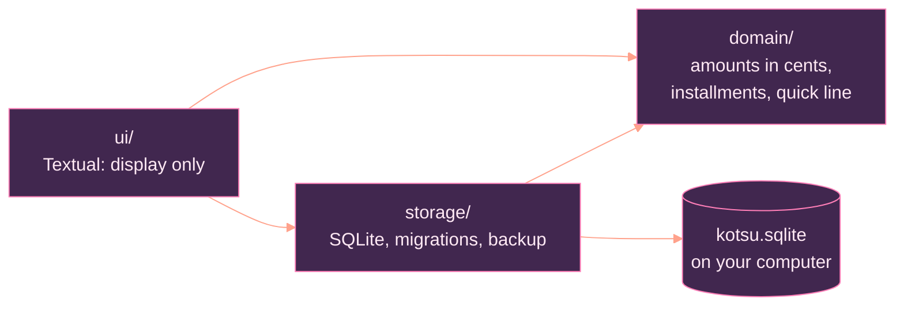

<p align="center">
  
</p>

<p align="center">
  
  
  
  
</p>

<p align="center">
  
  
  
</p>

<p align="center"><sub>Built with Python, Textual, SQLite and Claude</sub></p>

<p align="center"></p>

# Kotsu

**Kotsu** (コツコツ, *kotsukotsu*) is a Japanese word for "little by little, steadily". It is a terminal app for everyday finances: income, expenses and the month's installments on a single screen, in a pink and salmon **Cotton Candy** look. No giant spreadsheet, no dashboard full of charts. You jot an entry on one line, see the whole month and get on with your day.

It runs on Windows Terminal and Linux, works offline and keeps everything in a SQLite file on your computer. No account, no cloud, no telemetry, no ads.

## Contents

- [I. What it does](#i-what-it-does)
- [II. Install](#ii-install)
- [III. Use](#iii-use)
- [IV. Your data and backups](#iv-your-data-and-backups)
- [V. Updating from a Portuguese version](#v-updating-from-a-portuguese-version)
- [VI. Under the hood](#vi-under-the-hood)
- [VII. Development](#vii-development)
- [VIII. License](#viii-license)

## I. What it does

<table>
  <tr>
    <td width="72" align="center"></td>
    <td><b>Quick line</b><br><code>89,90 groceries #food @nubank</code> and Enter. No forms: the amount comes first, then account, category and date in any order.</td>
  </tr>
  <tr>
    <td align="center"></td>
    <td><b>One screen</b><br>Income, expenses and balance for the month, one line per account (each with its own color) and the list of entries. The ← / → arrows switch months.</td>
  </tr>
  <tr>
    <td align="center"></td>
    <td><b>Installments and "every month"</b><br><code>120 fridge @nubank 10x</code> becomes 10 installments, one per month. Categories marked "every month" (rent, internet, salary) show up on their own, with a <code>↻</code>.</td>
  </tr>
  <tr>
    <td align="center"></td>
    <td><b>Two Cotton Candy themes</b><br>Night (default) and light, with hearts, a little face and "zzz… zeroed" when an account is empty. The <code>t</code> key switches and your choice is saved.</td>
  </tr>
  <tr>
    <td align="center"></td>
    <td><b>Keyboard first</b><br>Everything has a key, and the footer reminds you which. Filter by <code>@account</code> or <code>#category</code> with <code>/</code>.</td>
  </tr>
  <tr>
    <td align="center"></td>
    <td><b>Truly private</b><br>Your data stays on your computer. Kotsu never sends anything over the network.</td>
  </tr>
</table>

## II. Install

<table>
  <tr>
    <td width="72" align="center"></td>
    <td>Requires Python 3.11 or newer and <a href="https://pipx.pypa.io/">pipx</a>.</td>
  </tr>
</table>

Windows Terminal (PowerShell), in one line:

```powershell
irm https://raw.githubusercontent.com/Sera-DAI/kotsu/main/install.ps1 | iex
```

Linux/macOS (needs pipx; the script tells you if it is missing):

```bash
curl -fsSL https://raw.githubusercontent.com/Sera-DAI/kotsu/main/install.sh | bash
```

Or step by step, without a script:

Windows Terminal (PowerShell):

```powershell
py -m pip install --user pipx
py -m pipx ensurepath
py -m pipx install kotsu-cli
```

Linux (Debian/Ubuntu):

```bash
sudo apt install pipx
pipx ensurepath
pipx install kotsu-cli
```

Reopen the terminal and run `kotsu`. To update: `pipx upgrade kotsu-cli` (or run the installer again). To remove: `pipx uninstall kotsu-cli` (your data stays in the data folder).

## III. Use

```text
 ☁ Cotton Candy ☁   November 2026

 ♡ income 3.500,00   ✧ expenses 432,90   ☆ balance 3.067,10   (◕‿◕)♡

 ♡ itaú     ♥♥♥♥♥♥♥♥♥·   income 3.500,00   expenses 210,50
 ♡ nubank   ♥♥♥♥♥♥♥♥♥♥   income     0,00   expenses 222,40

 Date   Description   Category   Account   Amount
 08/11  bakery        food       nubank    12,50
 07/11  groceries     food       nubank    89,90
```

| Key | Action |
|---|---|
| `l` | opens the quick line to log an entry (Enter saves, Esc closes) |
| ← / → | previous / next month |
| `/` | filters by `@account`, `#category`, both, or just a name (empty Enter or Esc clears) |
| `e` | edits the selected entry in the quick line, date included |
| `c` | copies the selected entry into the quick line, dated today |
| `d` | deletes the selected entry (an installment asks "only this one or all?") |
| `r` | renames the selected entry |
| `m` | turns "every month" on/off for the selected entry's category |
| `b` | manual database backup (a new copy in `backups/`) |
| `t` | switches the theme (Cotton Candy night or light) |
| `v` | shows the check code (same on another device = same data) |
| `q` | quits |

The line starts with the amount; the rest comes in any order:

```text
89,90 groceries #food @nubank          expense (no sign)
+3500 salary @itau                     income
120 fridge #home @nubank 10x           10 installments of 120,00, one per month
45 pharmacy yesterday                  date: today, yesterday, 15/10 or 15/10/2025 (default: today)
```

Every entry needs an `@account`; without one the line is not saved. An account or category that does not exist yet asks whether to create it. Editing or renaming an installment asks "only this one or all?" (`a` = all, `o` = only this). Amounts use a decimal comma and dates are day/month, as in Brazil.

### ↻ Categories that repeat every month

When you create a category, Kotsu asks whether it repeats every month (or press `m` on an existing one). Every new entry in it reappears each month with the same amount, account and day (day 31 becomes the last day of the month), with no end, until you stop it. Months appear as you navigate with ← / →, up to 24 months ahead of today. Deleting, editing or renaming one asks "only this month or the upcoming ones?" (`o` = only this month, `u` = this and upcoming).

## IV. Your data and backups

<table>
  <tr>
    <td width="72" align="center"></td>
    <td>
      <ul>
        <li><b>Where it lives:</b> <code>%APPDATA%\kotsu</code> on Windows and <code>~/.local/share/kotsu</code> on Linux (or the folder in the <code>KOTSU_DATA</code> variable). <code>kotsu --data FOLDER</code> opens another folder.</li>
        <li><b>A synced folder (two computers):</b> <code>kotsu --data-folder "G:\My Drive\Kotsu"</code> makes that folder this computer's data folder (it copies the database there the first time). Backups then go to the local folder, outside the sync. While Kotsu is open, a <code>kotsu.lock</code> file tells the other computer it is in use. If a computer shuts down with Kotsu open, its lock stops being refreshed and the other computer takes over by itself after 5 minutes; before that, Kotsu asks whether to open anyway (<code>kotsu --force</code> skips the question). <code>kotsu --default-data-folder</code> goes back to the local folder.</li>
        <li><b>Manual backup:</b> the <code>b</code> key creates <code>backups/kotsu.YYYY-MM-DD-HHMMSS.sqlite</code> and keeps the 5 most recent copies. Kotsu never backs up on its own.</li>
        <li><b>Merging with another device:</b> <code>kotsu --export data.json</code> writes everything to a file; on the other device, <code>kotsu --import data.json</code> merges it with what is there (the most recent change to each entry wins, and deleted entries stay deleted). Do it both ways and check: <code>kotsu --verify</code> shows a short code that is the same on both when the data is the same; <code>kotsu --verify data.json</code> lists the differences. Before importing, Kotsu saves <code>backups/kotsu.before-import.sqlite</code>.</li>
        <li><b>No password or encryption:</b> protect your computer and the folder as you would any personal file.</li>
        <li><b>Restore:</b> close the app, move the current <code>kotsu.sqlite</code> elsewhere, copy the chosen backup to <code>kotsu.sqlite</code>, open the app and check the totals.</li>
      </ul>
    </td>
  </tr>
</table>

## V. Updating from an older version

Opening a new version upgrades older data on its own, without losing anything:

- Files from the time Kotsu was called Money CLI (`money.sqlite`, its `money.before-*` copies and the backups) are renamed to `kotsu.*` the first time Kotsu opens. A file is never overwritten: if a `kotsu.sqlite` already exists, the old file is left where it is.
- With the data on Google Drive, update **every** computer before opening Kotsu again, so an older version does not create a new `money.sqlite` next to the renamed one.
- The old `money` command is gone: use `kotsu`. `pipx install --force kotsu-cli` (or `pipx upgrade kotsu-cli`) removes it.
- The Portuguese flags (`--dados`, `--pasta-dados`, `--forcar`, `--exportar`, `--importar`, `--conferir`) and the `MONEY_CLI_DADOS` variable were removed: use the English flags and `KOTSU_DATA`.
- Still on 0.1.0? Update to 0.1.1 first and open Kotsu once on each computer, then update again.

## VI. Under the hood

<table>
  <tr>
    <td width="72" align="center"></td>
    <td>Three layers, and a test fails if one of them imports what it must not. Financial rules (totals, installments, the quick-line parser) live in the domain; the screen only displays.</td>
  </tr>
</table>



- An amount is an integer number of cents, never a `float`; the sign comes from the kind (income or expense).
- Every write is a transaction: all or nothing. Changed the schema? A numbered migration, with a copy of the database made first.
- Totals are never stored: SQL computes them per month.

Full contributor rules: [AGENTS.md](AGENTS.md).

## VII. Development

<table>
  <tr>
    <td width="72" align="center"></td>
    <td>Requires Python 3.11+. The tests never touch the network.</td>
  </tr>
</table>

```bash
git clone https://github.com/Sera-DAI/kotsu.git
cd kotsu
python -m venv .venv
# Windows: .venv\Scripts\activate    Linux: source .venv/bin/activate
pip install -e ".[dev]"
kotsu --data ./tmp                 # uses a test folder
python tools/check.py --quick      # lint + fast tests
python tools/check.py              # everything, same as CI
```

## VIII. License

<table>
  <tr>
    <td width="72" align="center"></td>
    <td><a href="https://github.com/Sera-DAI/kotsu/blob/main/LICENSE">MIT</a>. Made with care, little by little.</td>
  </tr>
</table>

<p align="center"></p>
